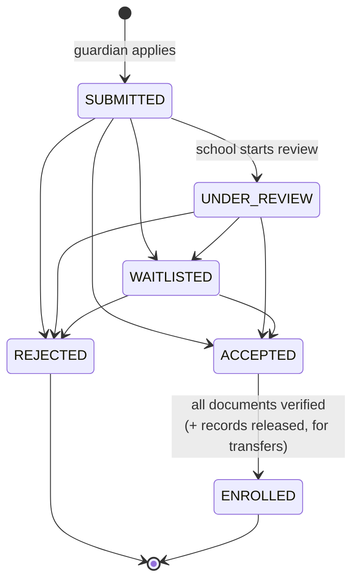
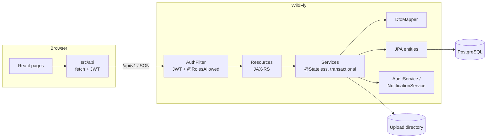

# EduGateway

School admissions and learner transfers for a district: guardians apply online, schools review
applications and verify documents, sending schools release records for transfers, and the
district office oversees everything through reports and an audit trail.

| Layer    | Technology                                                          |
|----------|---------------------------------------------------------------------|
| Frontend | React 19, React Router 7, Vite, Tailwind CSS 4                      |
| Backend  | Jakarta EE 10 (JAX-RS, EJB, JPA/Hibernate, Bean Validation), Java 17 |
| Server   | WildFly                                                             |
| Database | PostgreSQL                                                          |
| Auth     | JWT (HS512) bearer tokens, BCrypt password hashes                   |

## Roles

| Role               | Can do                                                                                          |
|--------------------|-------------------------------------------------------------------------------------------------|
| **Guardian**       | Register, manage learners, apply to open intakes, upload documents, track progress             |
| **School admin**   | Configure intakes, review applications, verify documents, decide, enrol, release transfer records |
| **District admin** | View all applications, add schools, see per-school reports and the full audit log              |

## Application lifecycle



An application is a **transfer** when the learner is already enrolled at another school. The
receiving school accepts it, the sending school then releases the learner's records, and only
then can the receiving school enrol the learner. Accepting is refused once an intake is full.

## Architecture



**Backend** (`backend/src/main/java/za/ac/ump/edugateway`)

| Package     | Responsibility                                                                                  |
|-------------|-------------------------------------------------------------------------------------------------|
| `resource`  | HTTP layer only: routes, status codes, role annotations. No business logic.                    |
| `service`   | Business rules and transactions. `Access` holds row-level rules (who may see which record).    |
| `entity`    | JPA mappings. `enums` holds the status lifecycle (`ApplicationStatus.canTransitionTo`).        |
| `dto`       | API contract: response records and validated request records (`Requests`).                    |
| `mapper`    | Entity → DTO conversion in one place.                                                           |
| `security`  | `AuthFilter` (authentication + `@RolesAllowed`/`@PermitAll`), `JwtUtil`, `CorsFilter`.          |
| `exception` | `ApiException` + mappers, so every error is `{"error": "..."}` with the right status code.      |
| `config`    | JAX-RS application and `AppSettings` (environment-driven configuration).                        |
| `seed`      | `DemoDataSeeder`: idempotent demo data loaded at startup.                                       |

Access control works in two layers. Role checks are annotations on resources; record-level
checks live in the services (a guardian sees only their own learners, a school admin only their
school's applications). Records you may not see return **404**, so their existence isn't leaked.

**Frontend** (`frontend/src`)

| Folder        | Responsibility                                                            |
|---------------|---------------------------------------------------------------------------|
| `api/`        | `client.js` (fetch, token, errors) and `index.js` (one function per endpoint) |
| `context/`    | `AuthContext` (session, login/logout), `ToastContext`                      |
| `hooks/`      | `useApi` (loading / error / reload state for any request)                  |
| `components/` | Shared UI: tables, application detail parts, upload button, charts        |
| `pages/`      | One folder per role, plus `shared/` pages used by every role               |
| `utils/`      | Formatting (status labels, dates) and CSV export                          |

## Getting started

### Prerequisites

- JDK 17+, Maven 3.9+
- Node.js 20+
- PostgreSQL 14+
- WildFly 30+ (Jakarta EE 10)

### 1. Database

```bash
psql -U postgres -f backend/scripts/setup-database.sql
```

### 2. WildFly datasource

Copy the PostgreSQL JDBC driver jar into `$WILDFLY_HOME/standalone/deployments/`, start
WildFly, then register the datasource:

```bash
$WILDFLY_HOME/bin/jboss-cli.sh --connect --file=backend/scripts/wildfly-datasource.cli
```

> **Windows note:** if WildFly fails to boot with `XNIO001001: No XNIO provider found`, Java
> can't create its internal loopback pipe under the 8.3 short temp path (`C:\Users\ADMINI~1\…`).
> Add this line to `bin\standalone.conf.bat`:
> `set "JAVA_OPTS=%JAVA_OPTS% -Djdk.net.unixdomain.tmpdir=C:\Temp\jdk"` (and create that folder).

### 3. Backend

```bash
cd backend
mvn package
cp target/edugateway.war $WILDFLY_HOME/standalone/deployments/
```

The API is then at `http://localhost:8080/edugateway/api/v1` (try `/health`). On first deploy
Hibernate creates the tables and the seeder loads demo data.

### 4. Frontend

```bash
cd frontend
npm install
npm run dev
```

Open http://localhost:5173. The Vite dev server proxies `/api` to WildFly, so no CORS setup is
needed in development.

### Demo accounts

All use the password `demo123`. The login page shows shortcut buttons in development builds.

| Role                                   | Email                         |
|----------------------------------------|-------------------------------|
| Guardian                               | `thandi.mokoena@example.com`  |
| School admin, Mpumalanga Academy       | `dlamini@mpuma.edu`           |
| School admin, Lydenburg High (sending) | `nkosi@lydenburg.edu`         |
| School admin, Kwena Primary            | `sithole@kwena.edu`           |
| District admin                         | `nomvete@edugateway.edu`      |

## Configuration

The backend reads each setting from a JVM system property or the matching environment variable.

| Environment variable           | Default                     | Purpose                                                        |
|--------------------------------|-----------------------------|----------------------------------------------------------------|
| `EDUGATEWAY_JWT_SECRET`        | dev-only value (logs a warning) | HMAC key for tokens, at least 32 characters. **Set in production.** |
| `EDUGATEWAY_JWT_TTL_HOURS`     | `8`                         | Session length                                                 |
| `EDUGATEWAY_UPLOAD_DIR`        | `~/edugateway-uploads`      | Where uploaded documents are stored (outside the web root)     |
| `EDUGATEWAY_UPLOAD_MAX_BYTES`  | `5242880`                   | Max upload size (5 MB)                                         |
| `EDUGATEWAY_CORS_ORIGINS`      | *(empty, CORS off)*         | Comma-separated origins allowed to call the API cross-origin   |
| `EDUGATEWAY_SEED_DEMO`         | `true`                      | Load demo schools/accounts/applications at startup             |

Frontend settings are in `frontend/.env.example`.

## API overview

All endpoints are under `/api/v1` and return JSON. Send `Authorization: Bearer <token>` except
where marked public.

| Method & path                          | Who                 | Purpose                                     |
|----------------------------------------|---------------------|---------------------------------------------|
| `POST /auth/login`                     | public              | Sign in (any role) → `{token, user}`        |
| `POST /auth/register`                  | public              | Guardian self-registration                  |
| `GET /auth/me`                         | any                 | Current user                                |
| `PUT /guardians/me`                    | guardian            | Update name / phone                         |
| `GET /guardians`                       | district            | All guardians                               |
| `GET /schools`, `POST /schools`        | any / district      | List / add schools                          |
| `GET /learners`, `POST`, `PUT /{id}`   | scoped / guardian   | Learners (own, or enrolled at your school)  |
| `GET /intakes?schoolId=&open=true`     | any                 | Intakes, optionally only open ones          |
| `POST /intakes`, `PUT /intakes/{id}`   | school admin        | Configure own school's intakes              |
| `GET /applications?status=`            | scoped              | Applications visible to the caller          |
| `GET /applications/{id}`               | scoped              | Detail: documents, history, guardian        |
| `POST /applications`                   | guardian            | Apply (`{learnerId, intakeId}`)             |
| `POST /applications/{id}/review`       | receiving school    | Mark under review                           |
| `POST /applications/{id}/decision`     | receiving school    | `{decision: ACCEPTED/WAITLISTED/REJECTED, reason}` |
| `POST /applications/{id}/enrol`        | receiving school    | Confirm enrolment                           |
| `PUT /applications/{id}/notes`         | receiving school    | Internal review notes                       |
| `POST /applications/{id}/documents`    | guardian            | Multipart upload (`type`, `file`)           |
| `GET /documents`                       | scoped              | Documents visible to the caller             |
| `PATCH /documents/{id}`                | receiving school    | `{status: VERIFIED/REJECTED, reason}`       |
| `GET /documents/{id}/file`             | scoped              | Download the file                           |
| `GET /transfers`, `GET /transfers/{id}`| scoped              | Transfers in/out of your school             |
| `POST /transfers/{id}/release`         | sending school      | Release academic records                    |
| `GET /notifications`                   | any                 | Your inbox                                  |
| `POST /notifications/{id}/read`, `/read-all` | any           | Mark as read                                |
| `GET /reports/summary?year=`           | school / district   | Dashboard figures (scoped to your school)   |
| `GET /reports/schools`                 | district            | Per-school statistics                       |
| `GET /reports/audit?limit=`            | district            | Audit log                                   |
| `GET /health`                          | public              | Liveness check                              |

## Tests

```bash
cd backend && mvn test        # unit tests (status lifecycle, JWT)
cd frontend && npm run lint   # oxlint
```

## Production notes

- Set `EDUGATEWAY_JWT_SECRET`, and set `EDUGATEWAY_SEED_DEMO=false`.
- `persistence.xml` uses Hibernate's `update` schema mode for convenience. Switch to a migration
  tool (Flyway or Liquibase) with `validate` before going live.
- Build the frontend with `npm run build` and serve `frontend/dist` behind the same origin as the
  API (for example a reverse proxy routing `/api` to WildFly), or set `VITE_API_BASE_URL` and
  `EDUGATEWAY_CORS_ORIGINS` for separate origins.
